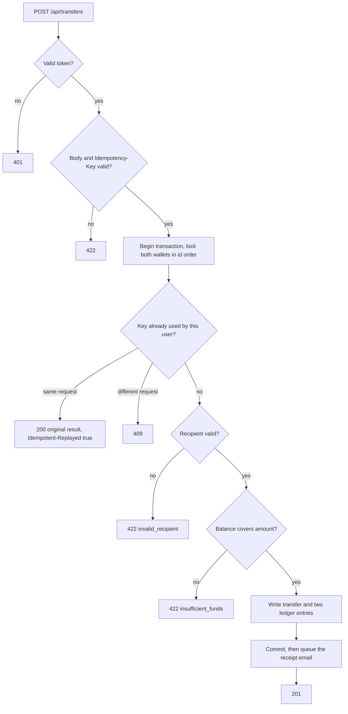

# wallet-api


A small wallet REST API in Laravel 13 where money cannot be sent twice, balances cannot drift, and one user cannot touch another's wallet: token auth, derived balances, idempotent transfers, a queued receipt email and a nightly reconciliation job.

By [Damilola Craig](https://dammycraig.ihub.website). It sits between two companion repos: [ledger-schema](https://github.com/dammydcraig/ledger-schema) (the double-entry design) and [webhook-verifier](https://github.com/dammydcraig/webhook-verifier) (trusting incoming payment events).

## Endpoints

| Method | Path | Auth | What it does |
| --- | --- | --- | --- |
| POST | `/api/register` | none | Creates a user and their wallet, returns a token |
| POST | `/api/login` | none | Returns a token. Five failures per email and IP per minute, then `429` |
| POST | `/api/logout` | token | Revokes the token used for the request |
| GET | `/api/wallet` | token | Your balance and latest 50 ledger entries |
| POST | `/api/transfers` | token | Sends money. Requires an `Idempotency-Key` header |
| GET | `/api/transfers/{id}` | token | A transfer you sent or received (`404` for anyone else) |

Amounts are integers in minor units (kobo for NGN). `150000` is ₦1,500.00. Decimals are rejected, so there is no floating-point money anywhere.

## Quick start

Requires PHP 8.3+ and Composer.

```bash
git clone https://github.com/dammydcraig/wallet-api.git
cd wallet-api
composer install
cp .env.example .env && php artisan key:generate
touch database/database.sqlite && php artisan migrate
php artisan test          # 36 tests
```

Try it:

```bash
php artisan serve &
H='-H Accept:application/json -H Content-Type:application/json'

curl -s $H -d '{"name":"Ada","email":"ada@example.com","password":"a-long-password-1"}' localhost:8000/api/register
curl -s $H -d '{"name":"Bola","email":"bola@example.com","password":"a-long-password-1"}' localhost:8000/api/register
php artisan wallet:fund ada@example.com 500000        # demo funding, refuses to run in production

curl -s $H -H "Authorization: Bearer <ada's token>" -H "Idempotency-Key: pay-2026-0001" \
  -d '{"to_wallet_id":"<bola'"'"'s wallet_id>","amount":150000}' localhost:8000/api/transfers
```

Send that last request twice. The second answer is `200` with `Idempotent-Replayed: true`, the same transfer id, and no second debit.

Receipts go through the queue, so run a worker with `php artisan queue:work`. With the default `MAIL_MAILER=log` they appear in `storage/logs/laravel.log`.

## How a transfer works



## Design decisions

- **Balances are derived, never stored.** A wallet's balance is the sum of its ledger entries. There is no balance column to fall out of step with history.
- **Every transfer is two entries that net to zero.** Money is moved, never created. Funding comes from a system wallet, the only wallet allowed to go negative.
- **Idempotency lives in the database, not only in code.** The `Idempotency-Key` is checked inside the transaction after the sender's wallet is locked, so a concurrent duplicate waits and then sees the first result. A unique index on `(user_id, idempotency_key)` is the backstop if two requests still race through. A stored hash of the request means the same key with a different body is a `409`, not a silent replay of the wrong thing.
- **A replay returns the original result,** even if the balance would no longer cover it. Failed attempts (such as insufficient funds) are not stored, so a retry with the same key after topping up works.
- **Row locks in a fixed order.** Both wallets are locked ordered by id, so two opposite transfers (A to B and B to A) cannot deadlock.
- **The sender is never read from the request.** It is always the authenticated user, so there is no `from` field to forge. Unknown extra fields are ignored.
- **No ids to tamper with on your own wallet.** `GET /api/wallet` takes no id. Transfers are readable only by their two parties, and anyone else gets `404`, not `403`, so the API does not confirm that a transfer exists. Ids are UUIDs.
- **Receipts are queued after commit.** A rolled-back transfer never sends a receipt, and a replay never sends a second one.
- **Login does not leak which emails exist.** Unknown email and wrong password return the same answer, and a password hash check runs either way.
- **Tokens expire** after 24 hours (`SANCTUM_TOKEN_EXPIRATION_MINUTES`) and logout revokes them.

## Reconciliation

`php artisan wallet:reconcile` runs nightly at 02:00 (see `routes/console.php`) and checks that:

1. every transfer's entries net to zero,
2. every transfer has exactly two entries that match its amount and its two wallets,
3. no user wallet is overdrawn.

If one fails, it prints the problem, logs at `critical` level and exits with a failure code, so a scheduler, monitor or alert can act on it. In production, run the scheduler with a single cron line: `* * * * * cd /path && php artisan schedule:run`.

## What the tests prove

36 tests cover registration, login, throttling, token expiry and revocation; transfers and their ledger entries; insufficient funds and the exact-balance edge; replays, conflicting keys and the unique index; access control; forged senders; the queued receipt; and each reconciliation check.

I also broke the code on purpose in 21 ways (no balance check, no idempotency lookup, ignoring the request hash, dropping the unique index, a one-sided ledger entry, allowing self-transfers, removing the access check, re-sending the receipt on replay, removing the login throttle, tokens that never expire, an unscheduled job, disabling each reconciliation check, and others) and confirmed the suite fails each time. The first round exposed two weak spots: a reconciliation check no test exercised, and a check that was mathematically redundant, which I removed.

**Not tested:** real concurrency. The tests run on SQLite, which serializes writers and ignores `lockForUpdate()`, so they prove the logic and the unique-index backstop but not that row locks hold under parallel load. Before relying on this, run a parallel-request test against PostgreSQL or MySQL.

## Limits

This is a reference project for study and demonstration. It has not been security audited and is not production banking software.

- **One currency (NGN) and one wallet per user.**
- **No money in or out.** There are no deposits or withdrawals from real providers. `wallet:fund` is a demo shortcut. Connecting a provider would use [webhook-verifier](https://github.com/dammydcraig/webhook-verifier) for the incoming events.
- **No reversals or refunds,** and no dispute flow. The ledger is append-only in practice, but nothing in the database enforces immutability. [ledger-schema](https://github.com/dammydcraig/ledger-schema) shows how triggers can.
- **Idempotency keys are kept forever** and never expire. A real system would expire them.
- **No email verification, password reset or MFA.**
- **Rate limits use the default cache store.** With several servers, use a shared one such as Redis.

## Roadmap

- A parallel-transfer test against PostgreSQL in CI
- Reversals and refunds
- A Dockerfile with a reverse proxy and TLS
- A deposit endpoint driven by verified webhooks

## License

MIT. See [LICENSE](LICENSE).
